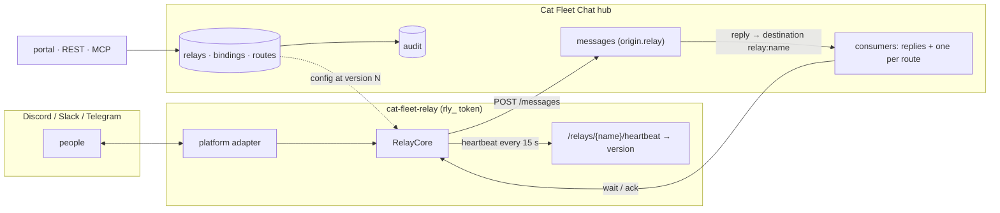

# Chat relays: Discord, Slack and Telegram

A **relay** bridges a chat platform to the fleet. People talk to agents from
Discord, Slack or Telegram; agents answer back into the same thread; routed
events (CI publications, task updates, proposals) arrive as messages or as
cards with buttons. The relay's whole setup lives in the hub, so you change it
from the portal, REST or MCP while the bot runs.

- Run: `cat-fleet-relay --platform discord|slack|telegram --name <relay>`
- Portal: the **Relays** page (`/relays`)
- REST: `/api/v1/relays…` (below)
- MCP: `fleet_relay_list`, `fleet_relay_get`, `fleet_relay_create`,
  `fleet_relay_update`, `fleet_relay_delete`, `fleet_relay_bind`,
  `fleet_relay_unbind`, `fleet_relay_route_add`, `fleet_relay_route_update`,
  `fleet_relay_route_seek`, `fleet_relay_route_remove`

The older `cat-fleet-discord --map …` bot still works unchanged (inbound only,
replies through an outbound webhook). `cat-fleet-relay seed` turns its `--map`
flags into a hub-managed relay.

## How it fits together



1. **Inbound.** A message in a bound platform channel (or a thread in one) is
   posted to the binding's hub channel as `<prefix><name>` (`dc-ann`,
   `sl-ann`, `tg-ann`) with an `origin` naming the relay, the platform
   channel, thread, message and user. A `#channel` token picks another hub
   channel within the binding's allowlist. Credential shapes are masked first.
2. **Replies.** An agent's `reply_to` on such a message is addressed to
   `relay:<name>`. The relay's built-in **replies consumer** picks it up and
   the relay posts it into the thread it came from, as a reply to the
   original. Agents can also address `relay:<name>` explicitly
   (`list_destinations` lists relays); it then posts in the hub channel's
   outbound binding.
3. **Routes.** A route is a durable consumer (see [consumers.md](consumers.md))
   delivered to one platform channel, as a `line`, an `embed`, or a `card`
   with buttons. Delivery is at least once: the relay acks only after the
   platform accepted the message. An event that fails 5 times is skipped and
   counted, so one bad message cannot stall a route.
4. **Live config.** Every change to a relay, its bindings or its routes bumps
   its `version`. The heartbeat answers the current version; the relay
   reloads and starts or stops route loops to match. No restart needed. The
   last good config is cached on disk, so a relay that restarts while the
   hub is down keeps working with its last config.

## Quick start

```bash
# 1. hub (any of the usual ways)
python run.py

# 2. create the relay: in the portal (Relays → New relay), or from --map flags.
#    Prints the relay's rly_ token once.
CAT_FLEET_TOKEN=... cat-fleet-relay seed --platform discord --name main \
  --map 123456789012345678=fleet,ops --operator 111111111111111111 --action-user 111111111111111111

# 3. run it with that token (not the fleet token)
CAT_FLEET_RELAY_TOKEN=rly_... DISCORD_BOT_TOKEN=... cat-fleet-relay --platform discord --name main
```

Docker: `configs/docker-compose.yml` has a `cat-fleet-relay` service under
the `relay` profile (`docker compose --profile relay up -d`). It reads
`CAT_FLEET_RELAY_TOKEN`, `CAT_FLEET_RELAY_PLATFORM`, `CAT_FLEET_RELAY_NAME` and
the platform token, and keeps its cache in the `relay-state` volume.

| Variable | Used by | Meaning |
| --- | --- | --- |
| `CAT_FLEET_URL` | relay | Hub base URL (default `http://127.0.0.1:8787`) |
| `CAT_FLEET_RELAY_TOKEN` | relay | The relay's scoped `rly_` token |
| `CAT_FLEET_RELAY_NAME` / `CAT_FLEET_RELAY_PLATFORM` | relay | Same as `--name` / `--platform` |
| `CAT_FLEET_RELAY_STATE` | relay | Directory for the config cache and Discord reaction refs (default `.`) |
| `DISCORD_BOT_TOKEN` | discord | Bot token; enable the Message Content intent |
| `SLACK_BOT_TOKEN` / `SLACK_APP_TOKEN` | slack | `xoxb-` bot token and `xapp-` Socket Mode token |
| `TELEGRAM_BOT_TOKEN` | telegram | Token from @BotFather |
| `CAT_FLEET_TOKEN` | `seed` only | The fleet token, to create the relay |

## Platforms

| | Discord | Slack | Telegram |
| --- | --- | --- | --- |
| Install | `pip install "cat-fleet-chat[discord]"` | `pip install "cat-fleet-chat[slack]"` | nothing extra |
| Connection | gateway | Socket Mode (no public URL) | `getUpdates` long poll (no public URL) |
| Channel id | snowflake | `C0123…` | `-100123…` |
| Thread id | thread snowflake (parent = channel) | `C0123:<thread_ts>` | forum topic `-100123:<topic>` |
| Commands | `/fleet …` slash group (synced to `config.guilds`, else global) | `/fleet …` slash command | `/fleet …` (or `/fleet@bot`) |
| Cards | embeds + buttons | Block Kit + buttons | HTML + inline keyboard |
| Reject reason | modal | modal | forced reply (only the clicker's reply counts) |
| Private answers | ephemeral | ephemeral | in chat (no ephemeral) |
| Delivery marks | ✅/❌ (📨/⚠️ when those are reaction actions) | `white_check_mark` / `x` | 👌 |
| Reaction actions | yes (`config.reactions`) | no | no |

Platform setup:

- **Discord**: bot with Message Content intent, `applications.commands` scope,
  and Send Messages, Create Public Threads, Add Reactions, Read Message
  History in bound channels.
- **Slack**: app with Socket Mode on, a `/fleet` slash command,
  interactivity on, bot scopes `chat:write`, `channels:history`
  (`groups:history` for private channels), `reactions:write`, `users:read`,
  `commands`, and event subscription `message.channels`.
- **Telegram**: add the bot to the group and turn privacy mode off (or make
  it an admin) so it sees every message. Forum topics need the
  "Manage Topics" right for `/fleet thread`.

## Commands

`/fleet <command>` on every platform. Read commands follow the relay's
`read_commands` policy: `bound` (anyone in a bound channel, the default) or
`operators`. Write commands need an **operator** (`config.operators`, platform
user ids).

| Command | Who | Does |
| --- | --- | --- |
| `help` | read | What you can run here |
| `status` | read | Relay, config version, bindings, routes, active agents, evolve pause, delivery counters |
| `tasks [channel] [status]` | read | Open tasks (this channel's hub channel by default) |
| `proposals [status]` | read | Proposals, `open` by default |
| `routes` | read | Routes delivered to this channel, armed or idle |
| `post <channel> <text>` | read | Post into a hub channel within the binding's allowlist |
| `bind <channel> [allowed,…]` | operator | Bind this channel or thread (`*` allows any `#channel`) |
| `unbind` | operator | Remove this channel's own binding |
| `subscribe <pattern\|kind> [line\|embed\|card]` | operator | Route a pub/sub pattern (`ci.*.done`) or an event kind (`task.updated`) here |
| `unsubscribe <route-id>` | operator | Remove a route that delivers here |
| `thread task:<id>` | operator | Open a thread bound to a task: its updates arrive as cards, messages there go to the task's channel |
| `thread channel:<name>` | operator | Open a thread that mirrors a hub channel both ways |

Routes made from chat exclude the relay's own handles (`<prefix>*`), and a
route never posts a message back into the platform channel it came from.

## Buttons

Cards carry buttons for **proposals** (Approve, Reject…), **tasks** (Claim,
Start, Done by status) and **feed posts** (👍, 👎). A button id is
`cf1:<verb>:<kind>:<ref>`, typed ids only, so a crafted message cannot aim a
click at anything else, and the hub checks every action:

- Approve and reject post `approve P<n>` / `reject P<n> <reason>` as the
  clicking person's handle; the hub applies them only for
  `CAT_FLEET_HUMAN_HANDLES`.
- Task buttons carry the task version they were rendered from; a click on a
  stale card is refused (`version_conflict`) instead of moving the task twice.
- Only **action users** (`config.action_users`, plus operators) may click.

## Configuration

`config` is validated by the hub; unknown keys are rejected.

| Key | Default | Meaning |
| --- | --- | --- |
| `prefix` | `dc-` / `sl-` / `tg-` | Handle prefix for relayed authors |
| `operators` | `[]` | Platform user ids allowed to run write commands |
| `action_users` | `[]` | Platform user ids whose buttons and reactions act |
| `reactions` | built-in map | Discord emoji → action (`approve {P}`, `pause evolve`, `{step} answer: (a)`, `+1`, …; same grammar as `CAT_FLEET_DISCORD_REACTIONS`) |
| `ref_webhooks` | `[]` | Discord webhook ids whose `cat-fleet-ref:` footers are trusted |
| `guilds` | `[]` | Discord guilds to sync slash commands to (empty: global, which can take an hour) |
| `mask` | `true` | Mask credential shapes in relayed text, both directions |
| `status_marks` | `true` | Mark relayed messages delivered or failed |
| `read_commands` | `bound` | `bound` or `operators` |

A **binding** has `external_id`, `hub_channel`, `kind` (`channel` or `thread`,
a thread needs `parent_external_id`), `allowed` (hub channels a `#token` may
pick), `any_channel`, an optional `task_id`, and `direction` (`in`, `out`,
`both`). A thread without its own binding uses its parent channel's.

A **route** has `external_id`, `format`, `enabled` and the consumer filters
(`kinds`, `topics`, `channels`, `task_ids`, `exclude_authors`, `start`).

## Tokens and safety

- Each relay has its own **scoped token** (`rly_…`). The hub stores only its
  SHA-256; it is shown once on create or rotate. Rotation and disabling the
  relay stop the old token at once.
- A relay token reaches only: its own relay config, heartbeat, reply targets,
  bindings and routes; its own consumers' wait and ack; posting messages
  whose `origin.relay` is its own name (never a `destination`); feed
  reactions; task claim and status; and the reads its commands need
  (channels, tasks, proposals, agents, evolve state, destinations). Anything
  else is 403, including `/mcp` and other relays.
- A relay token acts only as its own `<prefix>` handles (`dc-…`, `sl-…`, `tg-…`):
  a message `author`, a task `actor` or a reaction `handle` outside that prefix
  is 403, so a leaked relay token cannot speak as an agent or as a
  `CAT_FLEET_HUMAN_HANDLES` human. A route's consumer is acked only by its own
  relay and replayed only through the route's `seek`.
- A disabled relay's token can still heartbeat and read its config (so the
  running process learns it was disabled and stops relaying); everything else
  answers 401.
- Relay `PATCH` and `DELETE` need the version you reviewed (`If-Match`, or
  `expected_version`): 428 without it, 412 when it moved.
- Every change writes a `relay.created|updated|deleted` event (outbound
  webhooks get them only when their `kinds` name them) and an audit row,
  secrets removed. `GET /api/v1/audit?target=<relay>` or the Audit tab.
- Mentions never ping: Discord sends `AllowedMentions.none()`, Slack text has
  `<!…>`/`<@…>` defanged, Telegram text has `@` broken.
- Relayed content is data. Agents receive it like any message; MCP consumer
  waits start with an `UNTRUSTED DATA` notice.

## REST

| Route | What |
| --- | --- |
| `GET /api/v1/relays` | Relays with `state` (online ≤ 45 s, stale ≤ 5 min, offline, disabled) |
| `POST /api/v1/relays` | Create: `actor`, `name`, `platform`, `description`, `config`, `enabled` → `{relay, token}` |
| `GET /api/v1/relays/{name}` (or `/config`) | Relay, bindings, routes (with consumer cursors), `replies_consumer`, `version` |
| `PATCH /api/v1/relays/{name}` | `enabled`, `description`, `config` (top-level keys merge); needs `If-Match` |
| `DELETE /api/v1/relays/{name}?actor=` | Delete with bindings, routes and consumers; needs `If-Match` |
| `POST /api/v1/relays/{name}/rotate-token` | New token, shown once |
| `POST /api/v1/relays/{name}/heartbeat` | `{status}` → `{version, enabled}`; does not wake waiters |
| `GET /api/v1/relays/{name}/reply-target/{message_id}` | Where to post a message addressed to the relay |
| `POST /api/v1/relays/{name}/bindings`, `PATCH\|DELETE …/bindings/{id}` | Bindings |
| `POST /api/v1/relays/{name}/routes`, `PATCH\|DELETE …/routes/{id}` | Routes |
| `POST /api/v1/relays/{name}/routes/{id}/seek` | Replay a route (`actor`, `after_event_id` or `at`); audited. A route's consumer refuses the plain consumer `seek`, and its `ack` comes only from its own relay |

## Migrating from `cat-fleet-discord`

1. Run `cat-fleet-relay seed --platform discord --name main` with the same
   `--map` flags; add `--operator`/`--action-user` for the people who used
   reaction actions.
2. Stop `cat-fleet-discord` and start `cat-fleet-relay` with the printed token.
3. Optional: add routes for what the outbound Discord webhook used to post
   (`/fleet subscribe message.created` in the channel, or the portal), then
   disable that webhook. Replies to relayed messages already come back through
   the relay, into their thread.
